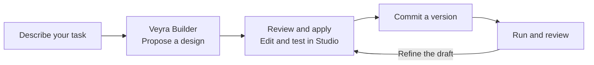
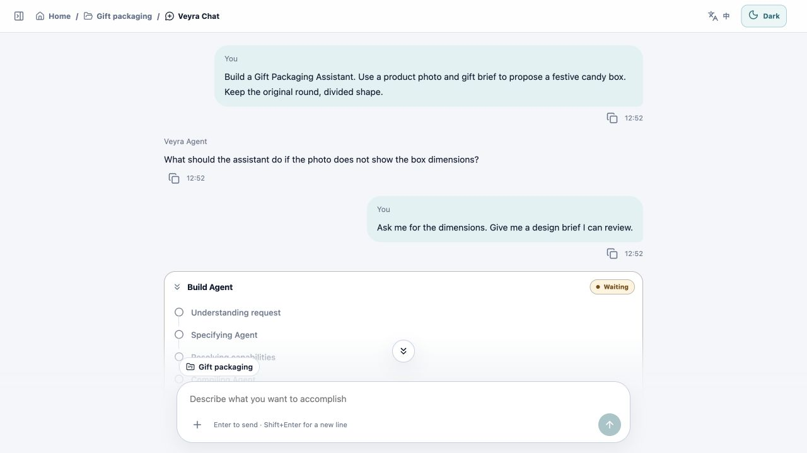
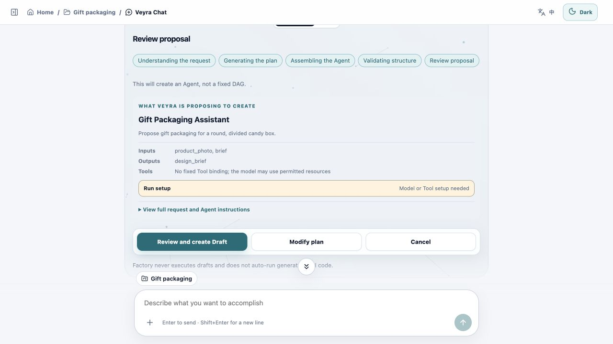

# Veyra Agent Platform

**Turn a request into a personalized Agent or Workflow you can see, edit, and reuse.**

Describe what you want to accomplish in Veyra Chat. Veyra's builder agent
uses your goal, expected outputs, and constraints to propose an Agent or
Workflow for your Project. Review the proposal, apply it, and keep refining
the resulting definition in the visual Studio.

## From request to reusable automation



1. **Describe the job.** Explain what you want to deliver, provide relevant
   materials, and specify limits such as permitted tools or steps that need
   your approval.
2. **Review what Builder proposes.** Inspect the proposed inputs, outputs,
   resources, and permissions. Apply the proposal when it fits your task.
3. **Make it yours in Studio.** Use the Canvas to inspect an Agent's
   capabilities or a Workflow's steps and branches. Edit the same definition
   in the canvas, form, or source view, then test the draft.
4. **Run, reuse, and improve it.** Commit a version and run that version with
   new inputs. Use the results and execution records to decide what to change,
   then edit the draft and commit a new version. Earlier runs retain their
   original version.

An **Agent** follows instructions and chooses among its permitted tools as it
works. A **Workflow** gives you explicit control over steps, branches,
approvals, and handoffs to specific Agent versions.

## Example · Build a Gift Packaging Assistant

### 1. Describe the Agent in Veyra Chat

> Build a Gift Packaging Assistant. Use a product photo and gift brief to
> propose a festive candy box. Keep the original round, divided shape.

In this example, Veyra asks what to do if the photo leaves out the box
dimensions. The user asks the Agent to request those dimensions and return a
design brief for review.



### 2. Review the generated Agent proposal

Builder turns the conversation into a proposal with a goal, inputs, outputs,
and instructions. The example accepts a product photo and brief and returns
a design brief. Review the proposal and select **Review and create Draft** to
create an editable Agent in the Project. Configure its model and any required
tools before testing.



The conversation and proposal above are examples displayed in the Veyra UI.

### 3. Edit, test, and reuse the draft in Studio

Open the Agent in Studio to adjust its instructions, input fields, and
capabilities. Test the draft, then commit a version you can run again with
new product photos and briefs.

For a job with explicit analysis, rendering, and output checks, ask Veyra for
a **Workflow**. The English Studio screenshot below shows an illustrative
Workflow draft for the same gift packaging task.


| Product photo | Generated design candidate |
| --- | --- |
|  |  |

The recorded walkthrough shows the original Workflow case and its image
candidate. The overall run failed, and the candidate still needs review.
[Watch the 40-second walkthrough](web/apps/community/public/showcase/veyra-gift-tour.mp4) ·
[Read the case notes](docs/SHOWCASE_MEDIA.md)

## Local workspace and Community

Projects, Builder conversations, files, and run records stay in the local
workspace. Configured model providers and tools may receive selected inputs.

To share an Agent, export its definition in Desktop and review it for
publication on the Community website. Community also accepts Plugin Packs.
You can download a shared resource and inspect it in Desktop before use.
[Community publishing and import guide](docs/COMMUNITY_WEBSITE.md)

## Quick start

These commands run a source checkout for development. In a hosted setup,
the operator runs the Community website and account API on a server. The
Electron application opens the local workspace when its bundled Local API is
ready. The Community entry opens the hosted site in the system browser.
[Community deployment guide](docs/community_production_storage.md)

Use Conda, Python 3.11, and Node.js 24 with npm. Run these commands from the
repository root. Create the Conda environment once and reuse it on later runs.

```sh
conda env create -f environment.yml
conda activate veyra-agent-platform
make install PYTHON=python
npm --prefix web ci
```

### Start the Desktop development workspace

Run the Local API and Desktop interface in separate terminals. Activate
`veyra-agent-platform` in the Python terminal.

| Service | Command | Local address |
| --- | --- | --- |
| Local API | `veyra-local` | `127.0.0.1:8771` |
| Desktop interface | `npm --prefix web run dev:desktop` | `127.0.0.1:5173` |

The Desktop browser preview uses a Community session. Its Vite proxy sends
account requests to the Community API at `127.0.0.1:8772`. Start that API using
the next section, then sign in to [Desktop](http://127.0.0.1:5173). The native
Electron application starts the Local API and opens the local workspace
directly.

Configure a model provider in Desktop Settings before asking Builder to
generate an Agent or running a model-backed task.

### Start the Community API for local sign-in and testing

Activate `veyra-agent-platform` in a separate terminal and run the Community
API from the repository root.

```sh
make migrate-community PYTHON=python
veyra-community
```

To create a test account, export the SMTP settings in the Community API
terminal before starting the service. [.env.example](.env.example)

### Preview the Community website

Run `npm --prefix web run dev:community` and open
[the local product showcase](http://127.0.0.1:5174). The demo and project
documentation are available before signing in. This website process is
optional for Desktop sign-in.

Set the Community website address when building Desktop to enable the
external Community link. The browser handles sign-in and publishing.
[Community and Desktop guide](docs/COMMUNITY_WEBSITE.md)

## Build and validate

```sh
make check PYTHON=python
npm --prefix web run typecheck
npm --prefix web test
npm --prefix web run build
```

Electron bundles the Desktop interface with the PyInstaller Local API
executable. The package workflow builds a macOS arm64 DMG, Windows x64
installer, and Linux x64 AppImage on their respective hosts. [Desktop packaging guide](docs/desktop_packaging.md)

## Project documentation

- [Community publishing and desktop import](docs/COMMUNITY_WEBSITE.md)
- [Desktop build and packaging](docs/desktop_packaging.md)
- [Community deployment and storage](docs/community_production_storage.md)
