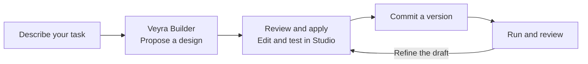
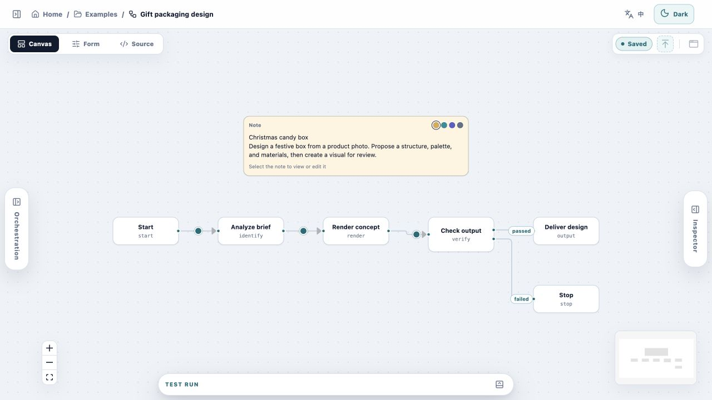

# Veyra Agent Platform

**Turn a request into a personalized Agent or Workflow you can see, edit, and reuse.**

Describe what you want to accomplish in Veyra Chat. Veyra's builder agent
uses your goal, expected outputs, and constraints to propose an Agent or
Workflow for your Project. Review the proposal, apply it, and keep refining
the resulting definition in the visual Studio.

## From request to reusable automation



1. **Describe the job.** Explain what you want to deliver, provide relevant
   materials, and specify limits such as permitted tools or steps that need
   your approval.
2. **Review what Builder proposes.** Inspect the proposed inputs, outputs,
   resources, and permissions. Apply the proposal when it fits your task.
3. **Make it yours in Studio.** Use the Canvas to inspect an Agent's
   capabilities or a Workflow's steps and branches. Edit the same definition
   in the canvas, form, or source view, then test the draft.
4. **Run, reuse, and improve it.** Commit a version and run that version with
   new inputs. Use the results and execution records to decide what to change,
   then edit the draft and commit a new version. Earlier runs retain their
   original version.

An **Agent** follows instructions and chooses among its permitted tools as it
works. A **Workflow** gives you explicit control over steps, branches,
approvals, and handoffs to specific Agent versions.

## Example · Design packaging for a gift

> Use my product photo to design a festive candy box. Keep the round,
> divided structure, suggest colors and materials, and make a concept image
> I can review.

The example below shows how that brief can become a Workflow in Studio.
Analysis, rendering, and output checks are visible as separate steps. A
reviewer can open the draft, adjust a step or its inputs, and commit the next
version for future runs.



| Product photo | Generated design candidate |
| --- | --- |
|  |  |

The Studio screenshot shows an illustrative draft. The recorded walkthrough
uses the original case and its image candidate. The overall run failed, and
the candidate still needs review.
[Watch the 40-second walkthrough](web/apps/community/public/showcase/veyra-gift-tour.mp4) ·
[Read the case notes](docs/SHOWCASE_MEDIA.md)

## Local workspace and Community

Projects, Builder conversations, files, and run records stay in the local
workspace. Configured model providers and tools may receive selected inputs.

To share an Agent, export its definition in Desktop and review it for
publication on the Community website. Community also accepts Plugin Packs.
You can download a shared resource and inspect it in Desktop before use.
[Community publishing and import guide](docs/COMMUNITY_WEBSITE.md)

## Quick start

Use Conda, Python 3.11, and Node.js 24 with npm. Run these commands from the
repository root. Create the Conda environment once and reuse it on later runs.

```sh
conda env create -f environment.yml
conda activate veyra-agent-platform
make install PYTHON=python
npm --prefix web ci
```

### Preview the website

Run `npm --prefix web run dev:community` and open
[the local product showcase](http://127.0.0.1:5174). The demo and project
documentation are available before signing in.

### Start the desktop workspace

Start each service in its own terminal from the repository root. Activate
`veyra-agent-platform` in each Python terminal.

| Service | Command | Local address |
| --- | --- | --- |
| Local API | `veyra-local` | `127.0.0.1:8771` |
| Community API | `make migrate-community PYTHON=python && veyra-community` | `127.0.0.1:8772` |
| Desktop interface | `npm --prefix web run dev:desktop` | `127.0.0.1:5173` |
| Community website | `npm --prefix web run dev:community` | `127.0.0.1:5174` |

Open [Desktop](http://127.0.0.1:5173) and sign in with an account on the
Community API you started. To create an account, set the SMTP variables shown
in [.env.example](.env.example) in the Community API terminal before starting
the service. Configure a model provider in Desktop Settings before asking
Builder to generate an Agent or running a model-backed task.

## Build and validate

```sh
make check PYTHON=python
npm --prefix web run typecheck
npm --prefix web test
npm --prefix web run build
```

The macOS arm64 desktop package is a release candidate. The repository contains
the source and build instructions, and CI checks the sidecar, application
signature, and DMG. [Desktop packaging guide](docs/desktop_packaging.md)

## Project documentation

- [Community publishing and desktop import](docs/COMMUNITY_WEBSITE.md)
- [Desktop build and packaging](docs/desktop_packaging.md)
- [Community deployment and storage](docs/community_production_storage.md)
