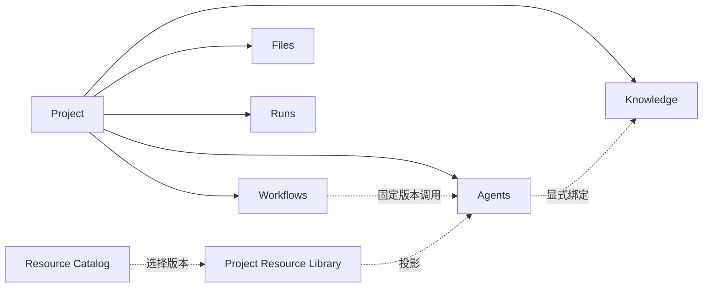
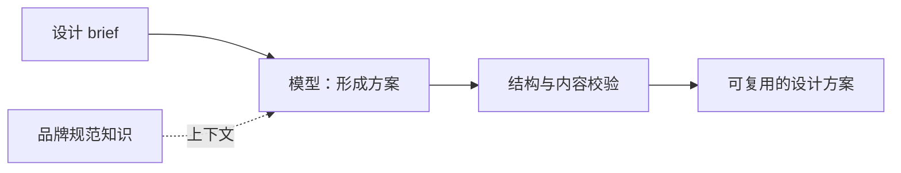

# ADR 0005：资源边界、固定版本调用与统一编辑

## 状态与依据

2026-09-06。本轮架构修订与实现边界；主设计仍为 `docs/PROJECT_DESIGN.md`。

依据：用户本轮需求、[共享架构讨论](https://chatgpt.com/share/6a9c0b6a-db5c-83ea-a446-92429cc6e4fb)，以及基于 `d6e05af` 的工作区改动。指定 Cursor 任务 ID 未能从可读取记录中找到，因此实现判断以实际代码和隔离测试为证据，不将共享讨论或页面图当作功能已实现的证明。

保留用户随后调整的导航：独立 Resource Library；Project 树下 Agents、Workflows、Knowledge、Files、Runs 分类。这里解释资源关系，不再次改写这版导航。

## 1. 四种核心对象，不是四级文件夹

- **Project**：拥有资源、管理默认设置与权限范围，不执行图。
- **Agent**：具备独立输入输出接口、可配置、可提交版本并独立运行的能力。内部组合模型、工具、知识上下文、转换和校验。
- **Workflow**：也是 Project 的资源；编排 Agent 调用、条件、审批和数据传递。模型、工具的实际工作由被调用的 Agent 承担。
- **Component**：可复用的构建材料。Primitive 由平台提供；Composite 表达可复用片段，不能冒充另一个自主 Agent。

Agent 和 Workflow 在归属上平级；Workflow → Agent 是调用关系。Agent →
Component 是组成或依赖关系。全局 Resource Catalog 负责发现平台能力，Project
Resource Library 负责锁定 Project 依赖；双击深入表示查看依赖对象，不会把
Agent 移进 Workflow 的目录。

旧 `parent_agent_id` 是组织关系，不具有执行语义。读取旧项目时保留它，不据此生成可执行 Workflow，不自动移动或删除旧 Agent。

## 2. Agent 里的“Agent 节点”如何处理

旧 `component_type: Agent` 实际是一次模型调用。产品统一展示为“模型 / Model”，新建节点使用 Model。为了旧文件、依赖锁和历史执行可追溯，旧 Agent wire 类型仍原样读写，不能静默改写历史定义或同版本 Catalog 内容。

`AgentCall` 是新的 Workflow 专属节点。它绑定：

- Agent ID；
- 已提交的不可变 `version_id`，不是当前草稿，也不是隐含的 latest；
- 该版本的 `source_hash`；
- 输入和输出映射。

本地调用引用写作 `agent_id@version_id`，两个 ID 都是 UUIDv7。发布资源的 `resource_id@semver` 是另一种引用；不能用一直未递增的 `1.0.0` 代替本地不可变版本。

服务端校验版本是否存在、是否属于当前 Project 和 Agent、摘要是否匹配，输入输出是否覆盖目标接口，输入变量在前序路径上是否存在且类型匹配。新版本不会改变既有调用；升级需要重新选择版本、审阅映射并保存新的 Workflow 版本。

## 3. 为什么两种图都需要输入和输出

Workflow 的输入输出是完整流程的接口；Agent 的输入输出是能力单元的接口。Workflow 将自身输入或上一调用结果映射给 Agent，Agent 不会因此再次要求用户填写同一份表单。

最小 Agent：输入 → 模型 → 输出。工具和知识都可选，不能强制每个用户填满五个节点。绑定知识表示提供模型上下文；显式检索步骤、模型动态工具循环与资料绑定是不同能力，不以相同连线混淆。

包装设计例子：

包装概念 Agent 内部：

生成效果图、编辑矢量图、生成印刷文件仍需要对应真实工具或模型适配器。不能把文本方案或图上的工具卡片描述成已经生成了可生产的包装文件。

## 4. 共用编辑器，不共用所有对象语义

共用选中、拖拽、连线、缩放、参数检查器、草稿保存、表单和源码投影；按 `Flow` / `Workflow` 区分节点集合、接口、依赖校验和运行入口。差异不只是 palette。

- Agent：模型、工具、转换、条件、审批、校验等内部步骤；不提供新增 AgentCall。
- Workflow：AgentCall 与控制流；即使从 Source 粘贴 Model 或 Tool 也必须拒绝。
- Component：列表、说明、参数、版本、依赖与引用关系。Primitive 不提供空白“编辑自身”画布。Composite 的制作与升级流程仍需独立实现。
- Knowledge：文档内容、元信息和引用管理。
- Files：原始文件索引；不是所有文件都自动成为模型知识。
- Runs：不可变执行身份、事件、结果和控制，不编辑源定义。

从 Workflow 打开 AgentCall 时先成功保存当前草稿。无效草稿或保存失败时留在原页并保留修改。默认打开引用版本的只读图和接口；“编辑 Agent 草稿”是独立操作。返回 Workflow 的导航保留来源，不把旧版本换成当前草稿。

## 5. 本轮补齐的执行边界

Workflow 本地运行会固定自身版本和每个 Agent 版本。每次调用产生独立 Agent Run，父 Run 保存调用节点、版本和子 Run 的关联；运行记录不写进 Project 源文件。

支持顺序调用、字段映射、条件、转换、人工审批、校验、输出、停止及事件回放。Workflow 权限必须覆盖被调用 Agent 的声明权限；子 Agent 自己的工具授权与审批仍由原 Runtime 执行，不因为父流程批准过就跳过。

审批等待持久化；重启不自动重放正在执行的外部效果。中断记录需要显式处理。当前仍是有界 DAG：不声称已支持通用循环、并行汇合、任意检查点恢复或外部调用的强制中止。

知识上下文通过 `extensions.veyra.knowledge_refs` 明确声明，并以文档摘要锁定。移动卡片不改变行为；替换知识引用会改变行为。首个切片读取 Project 内的 Markdown 文档，最多八份、总计 64 KiB，作为不可信参考内容交给模型。文件变化后拒绝运行，要求审阅后重新绑定；不会静默读取新内容。此能力是有界资料上下文，不是向量检索或完整 RAG。

## 6. 统一资源包与当前落地范围

目标是一个包协议、多个根类型：Project、Workflow、Agent、Component。每个包都需要根资源身份、版本、兼容性、内容清单、摘要和完整依赖；不是把所有目录直接压缩。

当前 `.vproject.zip` 已补齐 Project 的 Workflow、Knowledge 和其他声明资源清单，并携带 Workflow 实际引用的 Agent 版本快照。导入同时重映射资源 ID、版本 ID、引用和摘要，校验后才创建 Project；缺失或篡改依赖必须失败，不能留下看似成功的残缺项目。

当前 Project 包仍按既有规则包含可导出的 Project 文本资料。未来发布包需要单独的内容预览和知识/附件选择，默认排除用户原始资料。密钥、运行历史和聊天记录始终不属于定义包。

仅有 `PackageEnvelope` / `ResourceManifest` 合约并不代表通用打包完成：Agent 仍有单文件 YAML 导出；Component 独立包、依赖闭包解析、发布与社区升级尚未形成完整闭环。不能将同一个新文件后缀当作已经统一了整个协议。

## 7. 后续实现顺序与验收

1. **固定版本与运行证据**：本轮完成可执行切片；持续覆盖旧文件 hash、版本重用、跨 Project 引用拒绝、停止与审批、重启和包导入回归。
2. **资料与产物**：在现有有界上下文上增加知识快照历史、检索和引用出处；补充二进制图片/设计文件管理与真实设计工具适配器。
3. **组件制作与通用包**：实现 Composite 编辑、接口验证、插入后的来源追踪；定义“插入副本”和“版本引用”的区别，再统一 Agent / Workflow / Component 包的导入导出。
4. **社区闭环**：发布审核、下载、依赖解析、Fork、权限变化与版本升级；下载和 Factory 确认仍不自动运行。

每一阶段须给出真实服务响应、可操作页面及该修订的测试证据。没有适配器的节点、没有后端数据的页面，都不能用演示状态报成可运行。
